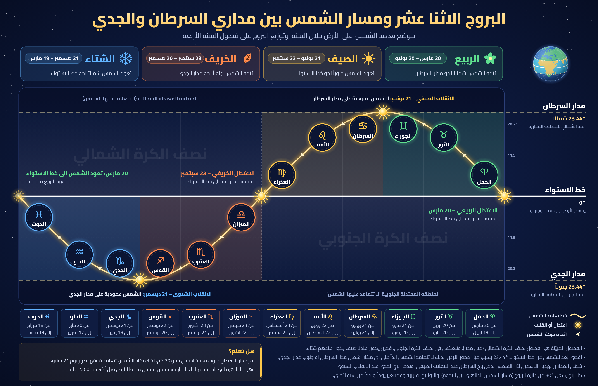

# البروج الاثنا عشر ومسار الشمس بين مداري السرطان والجدي



الصورة توضح البروج الاثني عشر التي تمر بها الشمس على مدار السنة، موزعة بين مدار السرطان ومدار الجدي مروراً بخط الاستواء، وكل برج في منطقة فصله:

| الفصل | البروج | موضع تعامد الشمس |
| --- | --- | --- |
| الربيع | الحمل، الثور، الجوزاء | من خط الاستواء شمالاً حتى مدار السرطان |
| الصيف | السرطان، الأسد، العذراء | من مدار السرطان عائدةً إلى خط الاستواء |
| الخريف | الميزان، العقرب، القوس | من خط الاستواء جنوباً حتى مدار الجدي |
| الشتاء | الجدي، الدلو، الحوت | من مدار الجدي عائدةً إلى خط الاستواء |

- المنحنى هو دائرة العرض التي تتعامد عليها الشمس (ميل الشمس) محسوباً من ميل محور الأرض `23.44°`.
- التواريخ هي مواعيد دخول الشمس كل برج بتوقيت مصر، وهي الأكثر تكراراً في الأعوام 2020–2035 (قد تختلف يوماً واحداً من سنة لأخرى).
- الفصول المذكورة لنصف الكرة الشمالي.

## الملفات

- `zodiac-tropics-map.png`: الصورة بدقة 3840×2480.
- `zodiac-tropics-map.svg`: نسخة متجهة (الخطوط مضمّنة داخل الملف).
- `build.mjs`: السكربت الذي يرسم الصورة.

## إعادة التوليد

```sh
npm install
npm run build
```

يحتاج السكربت إلى متصفح Chromium الخاص بـ Playwright (`npx playwright install chromium` إن لم يكن مثبتاً).
الخطوط: Cairo وNoto Sans Symbols (رخصة SIL OFL 1.1)، وخريطة اليابسة من Natural Earth عبر حزمة `world-atlas`.
